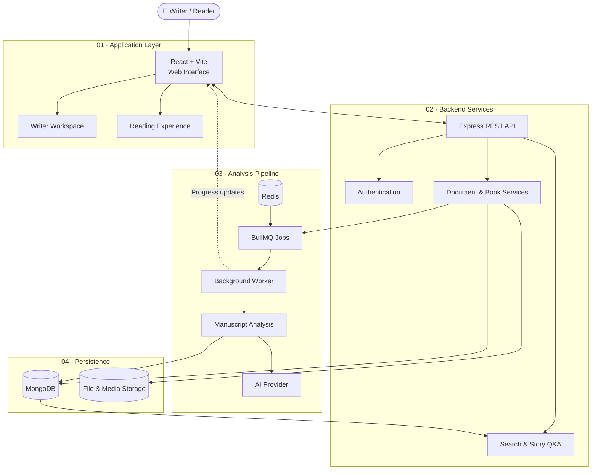
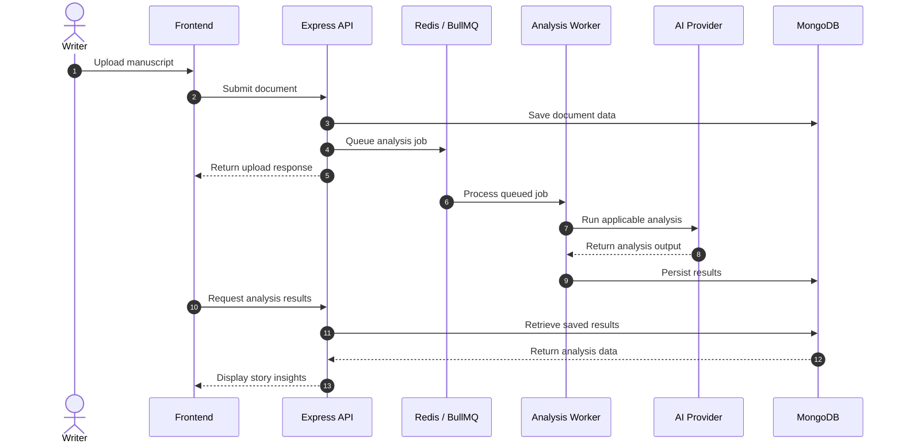

<div align="center">

# 📚 Storyloom

### AI-Powered Manuscript Analysis Platform

**Every story has more to explore.**

Turn lengthy manuscripts into explorable stories. Storyloom helps writers understand their scenes, characters, relationships, and story progression through AI-assisted analysis, manuscript search, and story-focused Q&A.

[](https://storyloom-sable.vercel.app)


</div>

---

## 🌌 The Idea Behind Storyloom

A story is more than a collection of pages. It is a network of characters, events, conversations, and connections that develop over time.

As a manuscript grows, keeping track of every detail becomes difficult. Storyloom brings these details into one place.

Upload a manuscript, explore its generated insights, search for relevant passages, or ask questions about the story. Alongside the writer's workspace, Storyloom also supports book discovery, reading lists, reviews, and publishing-related workflows.

## ✨ Core Features

### 📄 01 — Manuscript Intelligence

- Upload manuscripts and process them through a background analysis pipeline.
- Explore scenes and extracted character information.
- Examine character relationships and story timelines.
- Review dialogue, mood, story arcs insights.
- Track processing progress and revisit available results.

### 🔍 02 — Ask Q&A 

- Ask questions about a manuscript through a dedicated story Q&A flow.
- Retrieve answers grounded in relevant manuscript passages.

### 🧑‍🤝‍🧑 03 — A Space for Readers & Writers

- Discover books and explore book details.
- Maintain a personal library and reading list.
- Explore writer profiles and reviews.
- Support publishing requests, conversations, and notifications.

### ⚙️ 04 — Built for Asynchronous Work

- Queue manuscript-analysis jobs using BullMQ and Redis.
- Run longer processing tasks outside the initial upload request.
- Store analysis results in MongoDB for later retrieval.
- Use Socket.IO for supported real-time updates.

---

## 🏗️ System Architecture

The application separates the user experience, API handling, and manuscript processing. The frontend communicates with the backend, while background workers handle queued analysis tasks.



## 🔄 Inside the Manuscript Workflow



### 🧠 What the Analysis Explores

| Analysis stage | What it helps reveal |
|---|---|
| Scene Analysis | How a manuscript is divided into scenes |
| Character Analysis | Characters and their story details |
| Relationships | Connections between characters |
| Timeline | The sequence of story events |
| Dialogue | Dialogue-related information |
| Mood & Story Arc | Emotional tone and story development |

---

## 🛠️ Technology Stack

| Category | Technologies |
|---|---|
| Frontend | React |
| Backend | Node.js, Express.js |
| Database | MongoDB, Mongoose |
| Background Processing | BullMQ, Redis |
| Real-time Communication | Socket.IO |
| AI Integration | Configurable AI provider integration |
| Authentication | JWT, bcryptjs |
| Document Processing | Multer, PDF parsing, Mammoth |
| Media Storage | Local storage, Cloudinary configuration |

---

## 🔌 API Reference

Storyloom exposes REST endpoints for authentication, manuscript processing, story exploration, and reading workflows.

| Module | Endpoint | Purpose |
|---|---|---|
| Authentication | `POST /api/auth/register` | Register an account |
| Authentication | `POST /api/auth/login` | Authenticate a user |
| Documents | `GET /api/documents` | Retrieve documents |
| Documents | `POST /api/documents` | Upload a manuscript |
| Analysis | `GET /api/documents/:documentId/jobs` | Inspect analysis jobs |
| Scenes | `GET /api/documents/:documentId/scenes` | Retrieve scenes |
| Characters | `GET /api/documents/:documentId/characters` | Retrieve character information |
| Story | `/api/documents/:documentId/story/...` | Access story-analysis data |
| Story Q&A | `POST /api/documents/:documentId/search/ask` | Ask manuscript-related questions |
| Library | `/api/me/library` | Access the personal library |
| Publishing | `/api/publish-requests` | Manage publishing requests |


---

## 📁 Project Structure

```text
Storyloom/
├── frontend/
│   ├── src/
│   │   ├── components/
│   │   ├── pages/
│   │   ├── services/
│   │   └── ...
│   ├── package.json
│   └── .env.example
│
├── backend/
│   ├── src/
│   │   ├── routes/
│   │   ├── services/
│   │   ├── models/
│   │   ├── workers/
│   │   └── ...
│   ├── package.json
│   └── .env.example
│
└── README.md
```

---

##  Getting Started

### Prerequisites

- Node.js 
- MongoDB
- Redis
- Credentials for the configured AI provider

### 1. Clone the Repository

```bash
git clone https://github.com/Samiksha-Lohia/Storyloom.git
cd Storyloom
```

### 2. Start the Backend

```bash
cd backend
npm install
```

Create a `.env` file using `backend/.env.example` and configure the required database, Redis, authentication, and AI-provider settings.

Start the backend:

```bash
npm run dev
```

### 3. Start the Frontend

Open a separate terminal:

```bash
cd frontend
npm install
```

Configure `VITE_API_URL` using `frontend/.env.example` if necessary.

```bash
npm run dev
```

Open the local development URL shown in your terminal.

### Available Scripts

**Frontend**

```bash
npm run dev
npm run build
npm run lint
npm run preview
```

**Backend**

```bash
npm run
